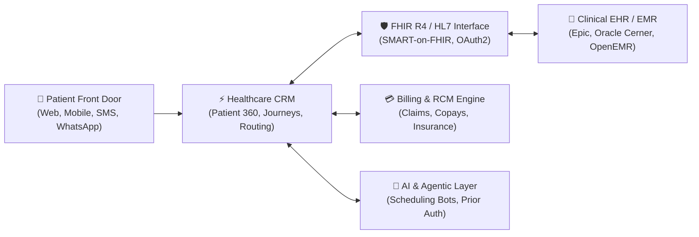

  

  
  
  
  
  
  
  

---

# 🏥 Awesome Enterprise Healthcare CRM

> A curated directory of leading **Enterprise Healthcare Customer Relationship Management (CRM)** SaaS platforms, open-source repositories, patient engagement engines, and clinical relationship management architectures.

Whether you are architecting a digital front door for an integrated delivery network (IDN), optimizing ambulatory intake workflows, orchestrating HIPAA-compliant patient communication journeys, or deploying self-hosted FHIR-native software, this guide tracks production-grade solutions across commercial and open-source domains.

---

## 📑 Table of Contents

- [🌐 Sector Overview & Market Dynamics](#-sector-overview--market-dynamics)
- [🏢 SaaS & Hosted Enterprise Platforms](#-saas--hosted-enterprise-platforms)
- [🔓 Open-Source GitHub Projects](#-open-source-github-projects)
- [🧩 Architecture & Interoperability Considerations](#-architecture--interoperability-considerations)
- [🤝 How to Contribute](#-how-to-contribute)
- [💖 Support & Sponsorship](#-support--sponsorship)
- [📈 Star History](#-star-history)
- [⚖️ Disclaimer](#️-disclaimer)

---

## 🌐 Sector Overview & Market Dynamics

The global **Healthcare CRM market** is valued at approximately **$20.6B – $24.0B in 2026** and is projected to expand to **$41B – $52B by 2030–2032**, compounding at an annual growth rate (CAGR) between **10.6% and 12.3%**.

### 📊 Market Fragmentation & Concentration Dynamics
* **Core Health System Concentration (Oligopoly / High Barrier):** The acute-care enterprise hospital tier demonstrates high concentration. Dominant electronic health record (EHR) monoliths (such as Epic Systems and Oracle Health) and hyperscale cloud providers (Microsoft and Salesforce) control the majority of enterprise budgets due to entrenched integration footprints and mission-critical clinical dependencies.
* **Specialized & Ambulatory Fragmentation (High Fragmentation):** The outpatient, specialty practice, life sciences, and patient acquisition segments remain moderately-to-highly fragmented. Point solutions for automated scheduling, AI call centers, direct-to-consumer health campaigns, and headless FHIR developer frameworks compete vigorously against traditional monolithic suites.
* **Open-Source Acceleration:** Increasing demand for data sovereignty, private sovereign AI models, zero-trust HIPAA compliance, and avoidance of per-seat lock-in has fueled rapid adoption of self-hosted, open-source patient engagement systems and FHIR datastores.

---

## 🏢 SaaS & Hosted Enterprise Platforms

The table below catalogs premier commercial SaaS Healthcare CRM platforms. Entries are sorted in **descending order by company size** (market capitalization, enterprise valuation, or annual revenue).

| 🏢 Platform | 💰 Company Size / Valuation | 🏷️ Starting Pricing | 🎁 Free Tier / Trial Limits | 🎯 Core Focus & Capabilities |
| :--- | :--- | :--- | :--- | :--- |
| **[Microsoft Cloud for Healthcare](https://www.microsoft.com/en-us/industry/health/microsoft-cloud-for-healthcare)** | **$3.1T Valuation** (Market Cap) _~$245B Annual Revenue_ | **$20,000 / tenant / month** (Core Healthcare add-on; user seats from **$105 / user / mo** for Dynamics 365 Customer Service) | **30-day free trial** Full Dynamics 365 & Power Apps healthcare sandbox environment, up to 25 user licenses, no credit card required | Unified Patient 360, Azure Health Data Services (FHIR/DICOM/IoT), clinical Teams care collaboration, remote patient monitoring (RPM), and contact center intelligence. |
| **[Cerner HealtheLife](https://www.cerner.com/)** _(Oracle Health)_ | **$420B Valuation** (Market Cap) _~$53B Annual Revenue (Cerner acquired for $28.3B)_ | **$25 / user / month** (Baseline clinical ambulatory portal user license; enterprise hospital contracts start at **$150,000 / year**) | **30-day guided trial** Interactive staging sandbox & provider portal evaluation environment for qualified health networks | Digital front door companion to Oracle Health EHR; features direct-book appointment scheduling, clinical lab/medication access, billing payment, and longitudinal wellness action plans. |
| **[Salesforce Agentforce Health](https://www.salesforce.com/health/)** | **$290B Valuation** (Market Cap) _~$35B Annual Revenue_ | **$325 / user / month** (Enterprise Edition, billed annually; Unlimited Edition starts at **$500 / user / mo**) | **30-day free trial** Dedicated pre-configured Health Cloud trial org with synthetic FHIR clinical data, 1 admin seat, no credit card required | Comprehensive patient and member services, FHIR R4 clinical data unification, care orchestration, referral management, and autonomous AI Agentforce workflows. |
| **[Epic Systems](https://www.epic.com/)** _(Epic Cheers)_ | **$38B Valuation** (Private) _~$4.9B Annual Revenue_ | **$5,000 / month** (Baseline Community Connect clinic tier; enterprise Cheers module licenses start at **$250,000 / year**) | **60-day sandbox trial** Structured staging and test harness environment for contracted Epic EHR provider organizations | Native EHR-embedded CRM module; powers MyChart digital front door, patient contact centers, proactive outreach campaigns, and conversational clinical AI agents. |
| **[Veeva Vault CRM](https://www.veeva.com/)** | **$34B Valuation** (Market Cap) _~$2.4B Annual Revenue_ | **$140 / user / month** (Core Vault CRM commercial seat, billed annually; enterprise deployments from **$115,000 / year**) | **30-day POC trial** Proof-of-Concept staging environment for qualified biopharma & life sciences enterprises upon sales qualification | Purpose-built life sciences CRM; features Agentic Call Reports, commercial HCP engagement, medical science liaison (MSL) tracking, and regulatory compliance. |
| **[Infor Healthcare](https://www.infor.com/industries/healthcare)** | **$13B Valuation** (Acquisition) _~$3.5B Infor Rev (Parent Koch: $125B+)_ | **$150 / user / month** (CloudSuite standard healthcare user tier; enterprise implementations from **$180,000 / year**) | **30-day guided POC** Interactive staging sandbox proof-of-concept for qualified hospital & health system administrators | Integrated healthcare ERP and CRM; manages patient relationship lifecycles, clinical operations workflows, staff scheduling, and hospital supply chain coordination. |
| **[Mercury Healthcare](https://mercuryhealthcare.com/)** _(WebMD / Internet Brands)_ | **$12B Valuation** (Parent Valuation) _~$2.5B Annual Revenue_ | **$1,250 / clinic / month** (Market outreach tier; enterprise health system campaigns start at **$45,000 / year**) | **14-day interactive demo** Guided sandbox with simulated patient acquisition journeys and audience segmentation for hospital marketing teams | Patient engagement platform, audience targeting, precision clinical campaign management, and hospital service-line volume growth. |
| **[Healthgrades](https://www.healthgrades.com/)** _(RVO Health / Red Ventures)_ | **$11B Valuation** (Parent Valuation) _~$2.0B Annual Revenue_ | **$49.95 / provider / month** (Elevated Profile tier; Enterprise CRM Audience & Campaign Insights starts at **$2,500 / month**) | **14-day trial** Provider Portal analytics access & profile verification trial for clinical practices (no permanent free tier) | Consumer health encounter data segmentation, predictive patient propensity modeling, and high-ROI hospital clinical outreach. |
| **[Innovaccer Cured](https://innovaccer.com/)** | **$3.2B Valuation** (Series E) _~$100M+ ARR_ | **$10 / patient / month** (CareAtlas care management tier; enterprise Cured HXP contracts start at **$50,000 / year**) | **30-day guided POC** Live sandbox access with simulated EHR/FHIR patient journeys for health system evaluators | 2026 Best in KLAS Healthcare Experience Platform (HXP); AI-driven patient journey orchestration, automated omni-channel messaging, and care gap closure. |
| **[LeadSquared Healthcare](https://www.leadsquared.com/)** | **$1.0B Valuation** (Series C) _~$35M+ ARR_ | **$60 / user / month** (Sales Pro healthcare plan, billed annually; regional tier starts at **₹2,500 / user / mo**) | **15-day free trial** Up to 10 user seats, full access to patient lead management, telephony integration, and HIPAA workflows, no credit card required | High-velocity patient intake, medical call center automation, multi-channel outreach (SMS, WhatsApp, Voice), and referral tracking. |

---

## 🔓 Open-Source GitHub Projects

The following repositories provide open-source codebases for patient relationship management, clinical coordination, EHR/EMR platforms, and hospital information systems. 

Entries are sorted in **descending order by GitHub star count**. Each repository badge links directly to its live stargazers page.

---

### 1. [Twenty CRM](https://github.com/twentyhq/twenty) 
- **License:** AGPL-3.0
- **Tech Stack:** TypeScript, React, NestJS, PostgreSQL, GraphQL
- **Healthcare Capabilities:** Modern CRM featuring custom data models easily structured for patient, provider, and care-team relationships. Includes an integrated AI assistant for natural language CRM queries, auto-generated REST/GraphQL APIs, role-based access control, and self-hosted Docker deployments suitable for custom HIPAA architectures.

---

### 2. [HospitalRun Frontend](https://github.com/HospitalRun/hospitalrun-frontend) 
- **License:** MIT
- **Tech Stack:** TypeScript, React, Redux, Node.js
- **Healthcare Capabilities:** Modern, offline-first hospital management and patient relationship interface designed for rural and low-resource healthcare facilities. Features intuitive patient registration, appointment scheduling, medication tracking, laboratory requests, and clinical workflow coordination.

---

### 3. [SuiteCRM](https://github.com/salesagility/SuiteCRM) 
- **License:** AGPL-3.0
- **Tech Stack:** PHP, Symfony, MariaDB / MySQL, JavaScript
- **Healthcare Capabilities:** Enterprise-grade CRM adaptable for hospitals and clinic networks. Custom healthcare modules support patient intake, referral tracking, prior authorization workflows, chronic condition care management, automated appointment reminders (SMS/Email), and demographic segmentation. Enterprise SuiteASSURED tier offers compliance warranties.

---

### 4. [OpenEMR](https://github.com/openemr/openemr) 
- **License:** GPL-3.0
- **Tech Stack:** PHP, MySQL, JavaScript, Docker
- **Healthcare Capabilities:** ONC-certified electronic health record and medical practice management platform. Includes a comprehensive patient portal for direct messaging, appointments, and lab results, paired with FHIR API integration, telehealth modules, e-prescribing, and medical billing capabilities.

---

### 5. [Fasten Health](https://github.com/fastenhealth/fasten-onprem) 
- **License:** AGPL-3.0
- **Tech Stack:** Go (Golang), Vue.js, SQLite / PostgreSQL, Docker
- **Healthcare Capabilities:** Self-hosted personal electronic health record and patient data aggregator. Connects with thousands of healthcare institutions via FHIR APIs to consolidate longitudinal patient charts, immunizations, vitals, appointments, and diagnoses into a single private database.

---

### 6. [Medplum](https://github.com/medplum/medplum) 
- **License:** Apache-2.0
- **Tech Stack:** TypeScript, React, Node.js, PostgreSQL, FHIR R4
- **Healthcare Capabilities:** Headless healthcare platform and developer toolkit that combines a compliant FHIR datastore, patient portal, CRM capabilities, automated bot workflows, and scheduling. Built natively around HL7 FHIR standards for rapid creation of modern patient applications.

---

### 7. [OpenMRS Core](https://github.com/openmrs/openmrs-core) 
- **License:** MPL-2.0
- **Tech Stack:** Java, Spring, Hibernate, MySQL
- **Healthcare Capabilities:** Globally recognized open-source enterprise electronic medical record platform. Manages longitudinal patient relationships, clinic encounters, cohort tracking, and clinical observation workflows across resource-constrained healthcare environments worldwide.

---

### 8. [HospitalRun Core](https://github.com/HospitalRun/hospitalrun) 
- **License:** MIT
- **Tech Stack:** JavaScript, Ember.js, PouchDB, CouchDB
- **Healthcare Capabilities:** The core backend and offline-first data synchronization engine for HospitalRun. Provides local-first database replication, discharge management, inventory tracking, and outpatient clinical relationship records.

---

### 9. [OpenBoxes](https://github.com/openboxes/openboxes) 
- **License:** EPL-1.0
- **Tech Stack:** Groovy, Grails, Java, MySQL
- **Healthcare Capabilities:** Open-source supply chain and medical inventory management system for health systems. Tracks pharmaceuticals, medical equipment, and consumable distributions across clinics, integrating with patient demand forecasting systems.

---

### 10. [Frappe Health / Marley](https://github.com/earthians/marley) 
- **License:** GPL-3.0
- **Tech Stack:** Python, Frappe Framework, MariaDB, Vue.js / JavaScript
- **Healthcare Capabilities:** Comprehensive healthcare and patient management module built on the Frappe/ERPNext ecosystem. Handles patient appointment booking, practitioner schedules, clinical encounter logs, vital signs tracking, lab test investigations, and billing synchronization.

---

### 11. [DHIS2 Core](https://github.com/dhis2/dhis2-core) 
- **License:** BSD-3-Clause
- **Tech Stack:** Java, Spring Boot, PostgreSQL, Web API
- **Healthcare Capabilities:** The world's leading open-source health information management system (HMIS), deployed in 100+ countries. Features the DHIS2 Tracker module for individual-level patient relationship tracking, disease surveillance, immunization follow-ups, and maternal health monitoring.

---

### 12. [Customermates](https://github.com/customermates/customermates) 
- **License:** AGPL-3.0
- **Tech Stack:** TypeScript, Next.js, Node.js, PostgreSQL, Docker
- **Healthcare Capabilities:** Modern open-source CRM featuring native Model Context Protocol (MCP) support for AI agents. Enables LLM assistants (Claude, Cursor, ChatGPT) to perform appointment coordination, patient outreach, and contact updates through 50+ pre-built tool endpoints.

---

### 13. [Bahmni Core](https://github.com/Bahmni/bahmni-core) 
- **License:** AGPL-3.0
- **Tech Stack:** Java, Spring, OpenMRS, OpenELIS, Odoo
- **Healthcare Capabilities:** Integrated hospital management system that combines OpenMRS for clinical patient charting, OpenELIS for laboratory management, and Odoo for patient billing and medical inventory into a unified clinical interface.

---

### 14. [nowCRM](https://github.com/nowtec/nowcrm) 
- **License:** AGPL-3.0
- **Tech Stack:** TypeScript, Node.js, PostgreSQL, Docker
- **Healthcare Capabilities:** Privacy-centric open-source CRM created for non-profits and healthcare entities demanding complete data sovereignty. Features visual automated journey builders, multi-channel messaging (Email, SMS, WhatsApp), and GDPR-compliant record handling.

---

### 15. [Helix](https://github.com/helix-medical/helix) 
- **License:** GPL-3.0
- **Tech Stack:** PHP, Symfony, Docker, SQLite / MySQL
- **Healthcare Capabilities:** Self-hosted patient management and scheduling system tailored for independent clinics, physical therapists, and osteopaths. Features calendar appointment booking, patient medical history tracking, billing generation, and GDPR-compliant local storage.

---

### 16. [PatientCrm](https://github.com/dotnetappdev/PatientCrm) 
- **License:** MIT
- **Tech Stack:** C#, .NET 10, Blazor, ASP.NET Core, SQL Server
- **Healthcare Capabilities:** Open-source patient CRM built for UK and European healthcare workflows (including NHS and HSCNI mock structures). Implements multi-role authentication (GP, Nurse, Dentist, Receptionist), passkey FIDO2 security, 2FA via TOTP, and OpenAPI/Swagger documentation.

---

### 17. [OpenHealthCRM](https://github.com/pras75299/OpenHealthCRM) 
- **License:** MIT / Modular
- **Tech Stack:** TypeScript, Next.js 16, React 19, Prisma 7, PostgreSQL
- **Healthcare Capabilities:** Modular clinic operations and patient relationship prototype. Features separate patient portal sessions, append-only audit logging, application-layer field encryption, Server-Sent Events (SSE) live vital telemetry streams, and an authenticated FHIR proxy for EHR synchronization.

---

## 🧩 Architecture & Interoperability Considerations

When selecting or architecting a healthcare CRM, enterprise IT teams must evaluate several critical technical pillars:

1. **Standards Compliance (HL7 & FHIR R4):** Patient demographics, encounters, appointments, and care plans must conform to USCDI and HL7 FHIR R4 specifications to avoid data siloing between the CRM and the underlying Electronic Health Record (EHR).
2. **Regulatory & Security Safeguards:** Systems storing Protected Health Information (PHI) require signed Business Associate Agreements (BAAs), SOC2 Type II certification, end-to-end TLS encryption, field-level encryption at rest, and immutable audit logs conforming to HIPAA and GDPR.
3. **Omni-Channel Patient Front Door:** Modern patients expect seamless intake across SMS, WhatsApp, interactive voice response (IVR), and web portals with two-way direct scheduling and appointment reminders.
4. **Agentic Workflows:** Modern 2026 implementations increasingly leverage Model Context Protocol (MCP) and LLM agents to automate referral processing, summarize clinical notes, and handle insurance eligibility verifications.

---

## 🤝 How to Contribute

Contributions are warmly welcomed! Help keep this repository accurate, comprehensive, and up to date:

1. 🍴 **Fork the repository** on GitHub.
2. 🌿 **Create a new branch**: `git checkout -b feat/add-new-crm`.
3. 📝 **Add or update an entry** in `README.md` (adhere to existing tabular format for SaaS or bullet format for open-source).
4. 🔍 **Verify links and facts**: Ensure pricing, free tier limits, star badges, and official URLs are accurate.
5. 🚀 **Submit a Pull Request** with a concise description of your additions.

Please review our [contribution guidelines](https://github.com/ishandutta2007/Awesome-Awesome-Awesome) for community standards.

---

## 💖 Support & Sponsorship

If you find this repository valuable for your healthcare organization, research, or development stack, please consider supporting the project:

- ⭐ **Star this repository** to help others discover it.
- 🍴 **Fork and share** with colleagues and healthcare technology communities.
- ☕ **Buy me a coffee / Sponsor**: Support continued curation and open-source healthtech initiatives via the **[GitHub Sponsors Dashboard](https://github.com/sponsors/ishandutta2007)**.

Thank you to all contributors and healthcare builders making healthcare technology more accessible, interoperable, and patient-centric! ❤️

---

## 📈 Star History

---

## ⚖️ Disclaimer

- This repository is a **community-curated index** intended for research, evaluation, and educational purposes. Inclusion does not imply official endorsement.
- All trademarks, service marks, and company names are the property of their respective owners.
- Healthcare organizations handling Protected Health Information (PHI) must execute proper Business Associate Agreements (BAAs), perform thorough security hardening, and ensure regulatory compliance prior to clinical deployment.
